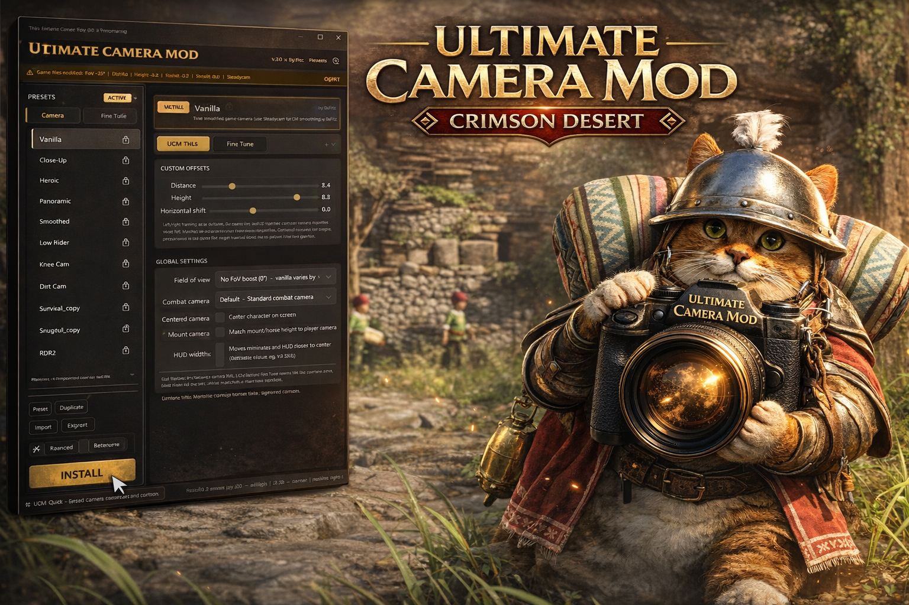
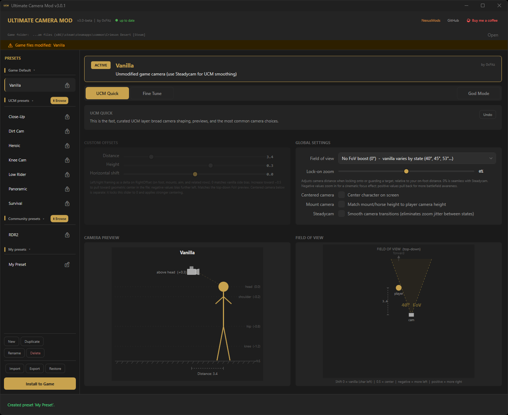
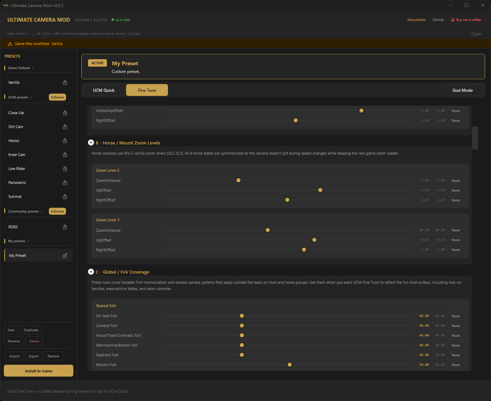
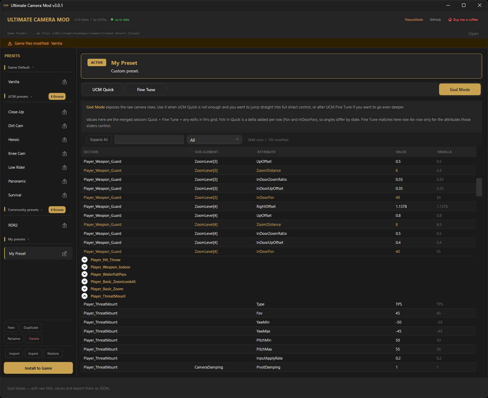
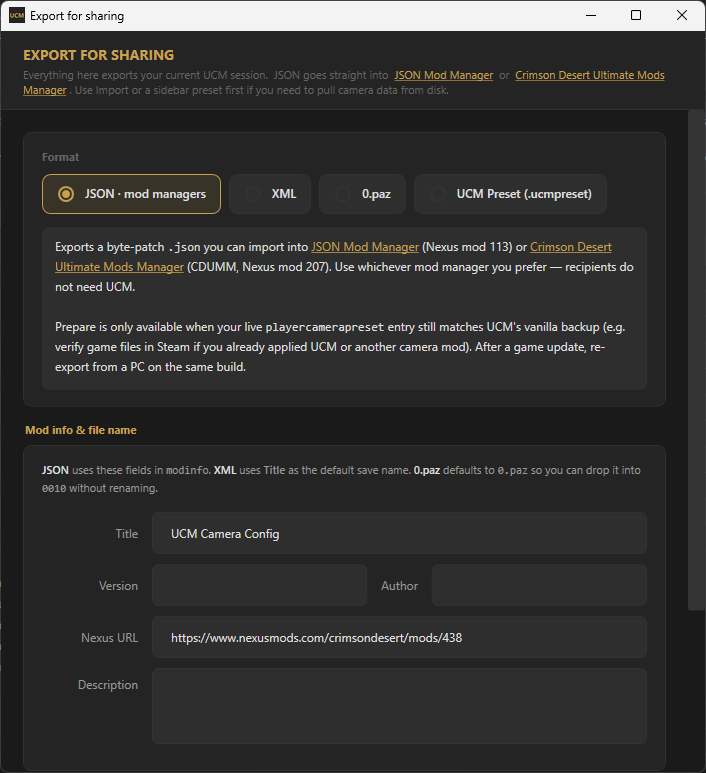
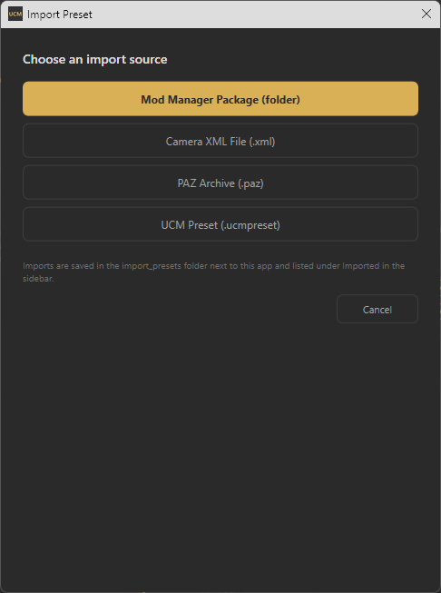

[English](../../README.md) | [한국어](README.ko.md) | [日本語](README.ja.md) | [简体中文](README.zh-CN.md) | [繁體中文](README.zh-Hant.md) | [ไทย](README.th.md) | [Bahasa Indonesia](README.id.md) | **Türkçe** | [Polski](README.pl.md) | [Italiano](README.it.md) | [Svenska](README.sv.md) | [Norsk](README.nb.md) | [Dansk](README.da.md) | [Suomi](README.fi.md) | [Deutsch](README.de.md) | [Français](README.fr.md) | [Español](README.es.md) | [Português (BR)](README.pt-BR.md) | [Русский](README.ru.md)

---

> **v3.2 yayınlandı!** Sacred God Mode geçersiz kılma, Lock-on Auto-Rotate açma/kapama ve tüm hata düzeltmeleri. **[GitHub Releases](https://github.com/FitzDegenhub/UltimateCameraMod/releases/latest)** veya **[Nexus Mods](https://www.nexusmods.com/crimsondesert/mods/438)** üzerinden indirin.

# Ultimate Camera Mod - Crimson Desert

Crimson Desert için bağımsız kamera aracı. Tam GUI, canlı kamera önizleme, üç katmanlı düzenleme, dosya tabanlı preset'ler, **[JSON Mod Manager](https://www.nexusmods.com/crimsondesert/mods/113)** ve **[Crimson Desert Ultimate Mods Manager](https://www.nexusmods.com/crimsondesert/mods/207)** (CDUMM) için **JSON dışa aktarma** ve geniş ekran HUD desteği.

<p align="center">
  
</p>

<p align="center">

[](https://github.com/FitzDegenhub/UltimateCameraMod/releases/tag/v3.2)
[](https://www.nexusmods.com/crimsondesert/mods/438)
[](https://github.com/FitzDegenhub/UltimateCameraMod/wiki)

[](https://www.virustotal.com/gui/file-analysis/ZWMzZGM4MGM3ZWFlZTY5MTFmZDYwYzNkODFlZGM4Mjg6MTc3NTkxMzY4Mg==)
[](https://www.reddit.com/r/CrimsonDesert/comments/1sfou61/ucm_ultimate_camera_mod_v3_crimson_desert_full/)
[](LICENSE)
[](https://ko-fi.com/0xfitz)

</p>

> Yardıma mı ihtiyacınız var? Kurulum kılavuzları, kamera ayarlarının açıklamaları, preset yönetimi, sorun giderme ve geliştirici belgeleri için **[Wiki](https://github.com/FitzDegenhub/UltimateCameraMod/wiki)** sayfasına göz atın.

---

<details>
<summary><strong>Ekran görüntüleri (v3.x)</strong> -- genişletmek için tıklayın</summary>
<br>

**UCM Quick** -- mesafe, yükseklik, kaydırma, FoV, lock-on zoom, steadycam, canlı önizlemeler


**Fine Tune** -- aranabilir çerçeveli kartlarla seçilmiş derin ayar


**God Mode** -- vanilla karşılaştırmalı tam ham XML düzenleyici


**JSON Dışa Aktarma** -- JSON Mod Manager / CDUMM için dışa aktarma


**İçe Aktarma** -- .ucmpreset, XML, PAZ veya Mod Manager paketlerinden içe aktarma


</details>

---

## Dal genel bakışı

| Dal | Durum | Açıklama |
|-----|-------|----------|
| **`main`** | v3.2 Sürüm | Üç katmanlı düzenleyici (UCM Quick / Fine Tune / God Mode), dosya tabanlı preset'ler, topluluk kataloğu, çoklu format dışa aktarma ve doğrudan PAZ kurulumu içeren bağımsız kamera aracı |
| **`development`** | Geliştirme | Sonraki sürüm geliştirme dalı |

v3, v2'deki tüm kamera özelliklerini yeniden tasarlanmış bir arayüz, dosya tabanlı preset'ler, üç katmanlı düzenleyici ve çoklu format dışa aktarma ile birlikte içermektedir. Doğrudan PAZ kurulumu, v3'te ikincil bir seçenek olarak hâlâ mevcuttur.

---

## Özellikler

### Kamera kontrolleri

| Özellik | Detaylar |
|---------|----------|
| **8 yerleşik preset** | Panoramic, Heroic, Vanilla, Close-Up, Low Rider, Knee Cam, Dirt Cam, Survival - canlı önizleme ile |
| **Özel kamera** | Mesafe (1.5-12), yükseklik (-1.6-1.5) ve yatay kaydırma (-3-3) için kaydırıcılar. Orantısal ölçekleme, tüm yakınlaştırma seviyelerinde karakteri aynı ekran konumunda tutar |
| **Görüş alanı** | Vanilla 40 dereceden 80 dereceye kadar. Savunma, nişan, binek, süzülme ve sinematik durumlarda evrensel FoV tutarlılığı |
| **Merkezlenmiş kamera** | 150'den fazla kamera durumunda karakteri tam ortaya alarak sol ofsetli omuz kamerasını ortadan kaldırır |
| **Lock-on zoom** | -%60 (hedefe yakınlaştırma) ile +%60 (geri çekilme) arasında kaydırıcı. Tüm lock-on, savunma ve hamle durumlarını etkiler. Steadycam'den bağımsız çalışır |
| **Lock-on auto-rotate** | Kilitleme sırasında kameranın hedefe yapışmasını devre dışı bırakın. Arkanızda kalan düşmanlara kameranın hızla dönmesini önler. [@sillib1980](https://github.com/sillib1980)'e teşekkürler |
| **Binek kamera senkronizasyonu** | Binek kameraları seçtiğiniz oyuncu kamera yüksekliğine uyum sağlar |
| **Tüm bineklerde yatay kaydırma** | At, fil, ejderha, kano, savaş makinesi ve süpürge, orantısal ölçekleme ile kaydırma ayarınıza uyar |
| **Yetenek nişan tutarlılığı** | Fener, Kör Etme Işığı, Yay ve tüm nişan/yakınlaştırma/etkileşim yetenekleri yatay kaydırmayı uygular. Yetenekleri etkinleştirirken kamera atlama yapmaz |
| **Steadycam yumuşatma** | 30'dan fazla kamera durumunda normalleştirilmiş karıştırma zamanlama ve hız sallanımı: boşta, yürüme, koşma, sprint, savaş, savunma, hamle/şarj, serbest düşüş, süper zıplama, ip çekme/sallanma, geri tepme, tüm lock-on varyantları, binek lock-on, diriltme lock-on, tahrik/aranma, savaş makinesi ve tüm binek durumları. Her değer, Fine Tune düzenleyicisi aracılığıyla topluluk tarafından ayarlanabilir |
| **Sacred God Mode** | God Mode'da düzenlediğiniz değerler, Quick/Fine Tune yeniden oluşturmalarına karşı kalıcı olarak korunur. Yeşil göstergeler hangi değerlerin korunmuş olduğunu gösterir. Preset bazında depolama |

> **v3 tasarım felsefesi: sadece değer düzenleme, yapısal enjeksiyon yok.**
>
> Önceki sürümler kamera dosyasına yeni XML satırları enjekte ediyordu (ekstra yakınlaştırma seviyeleri, at birinci kişi modu, ek yakınlaştırma katmanlarıyla at kamerası revizyonu). v3 bu özellikleri bilerek kaldırır. Yapı enjeksiyonunun oyun güncellemelerinden sonra bozulma olasılığı çok daha yüksektir ve niş kamera modları için kişisel tercihler, mod yöneticileri aracılığıyla dağıtılan özel modlarla daha iyi karşılanır. UCM artık yalnızca mevcut değerleri değiştirir -- aynı satır sayısı, aynı eleman yapısı, aynı özellikler. Bu, preset'lerin paylaşımını daha güvenli ve oyun yamaları arasında daha dayanıklı kılar.

### Üç katmanlı düzenleyici (v3)

v3, istediğiniz kadar derine inebilmeniz için düzenlemeyi üç sekmeye ayırır:

| Katman | Sekme | Ne yapar |
|--------|-------|----------|
| 1 | **UCM Quick** | Hızlı katman - mesafe/yükseklik/kaydırma kaydırıcıları, FoV, merkezlenmiş kamera, lock-on zoom (-%60 ile +%60), lock-on auto-rotate, binek senkronizasyonu, steadycam, canlı kamera + FoV önizlemeleri |
| 2 | **Fine Tune** | Seçilmiş derin ayar. Yaya yakınlaştırma seviyeleri, at/binek yakınlaştırma, genel FoV, özel binekler ve gezinti, savaş ve lock-on, kamera yumuşatma ve nişan ve nişangah pozisyonu için aranabilir bölümler. UCM Quick üzerine inşa eder |
| 3 | **God Mode** | Tam ham XML düzenleyici - kamera durumuna göre gruplandırılmış, aranabilir, filtrelenebilir DataGrid'de her parametre. Vanilla karşılaştırma sütunu. Yeniden oluşturmalara karşı korunan Sacred geçersiz kılmalar (yeşil). "Yalnızca Sacred" filtresi. 54 özellik ipucu |

### Dosya tabanlı preset sistemi (v3)

- **`.ucmpreset` dosya formatı** - UCM kamera preset'leri için paylaşılabilir özel format. Herhangi bir preset klasörüne bırakın, çalışır
- **Yan çubuk yöneticisi** - daraltılabilir gruplandırmalı bölümlerle: Oyun Varsayılanı, UCM Preset'leri, Topluluk Preset'leri, Preset'lerim, İçe Aktarılmış
- Yan çubuktan **Yeni / Kopyala / Yeniden Adlandır / Sil**
- Kazara düzenlemeyi önlemek için preset'leri **kilitleyin** - UCM preset'leri kalıcı olarak kilitlidir; kullanıcı preset'leri asma kilidi simgesiyle açılıp kapatılabilir
- **Gerçek Vanilla preset'i** - oyun yedeğinizdeki ham çözülmüş `playercamerapreset`, hiçbir değişiklik uygulanmamış. Hızlı kaydırıcılar gerçek oyun temel değerlerine senkronize edilir
- **İçe aktarma** - `.ucmpreset`, ham XML, PAZ arşivleri veya Mod Manager paketlerinden. `.ucmpreset` içe aktarmaları tam UCM kaydırıcı kontrolü sağlar; ham XML/PAZ/mod manager içe aktarmaları bağımsız preset'lerdir (yalnızca God Mode düzenleme, UCM kuralları uygulanmaz) - orijinal mod yazarının değerlerini korumak için
- **Otomatik kayıt** - kilitlenmemiş preset'lerdeki değişiklikler otomatik olarak preset dosyasına yazılır (geciktirilmiş)
- İlk başlangıçta eski `.json` preset'lerden `.ucmpreset`'e otomatik geç

### Preset katalogları (v3)

Preset'leri doğrudan UCM içerisinden gözatıp indirin. Tek tıkla indirme, hesap gerekli değil.

- **UCM Preset'leri** - 7 resmi kamera stili (Heroic, Panoramic, Close-Up, Low Rider, Knee Cam, Dirt Cam, Survival). Tanımlar GitHub'da barındırılıyor, oturum XML'i oyun dosyalarınız + güncel kamera kurallarınızla yerel olarak oluşturuluyor. Kamera kuralları güncellendiğinde otomatik yeniden oluşturur
- **[Topluluk preset'leri](https://github.com/FitzDegenhub/UltimateCameraMod/tree/main/community_presets)** - ana depodaki topluluk tarafından katkı sağlanmış preset'ler, katalog GitHub Actions tarafından otomatik oluşturulur
- Her yan çubuk grup başlığında **Gözat butonu** katalog tarayıcısını açar
- Her preset ad, yazar, açıklama, etiketler ve yazarın Nexus sayfasına bağlantı gösterir
- **Güncelleme algılama** - katalogda daha yeni bir sürüm mevcut olduğunda yanıp sönen güncelleme simgesi. Güncellemeyi indirmek için tıklayın, isteğe bağlı olarak Preset'lerim'e yedekleme
- İndirilen preset'ler yan çubukta görünür (varsayılan olarak kilitli - düzenlemek için kopyalayın)
- Güvenlik için **2MB dosya boyutu sınırı** ve JSON doğrulaması

**Preset'inizi toplulukla paylaşmak mı istiyorsunuz?** UCM'den `.ucmpreset` olarak dışa aktarın, ardından:
- `community_presets/` klasörüne preset'inizi ekleyen bir [Pull Request](https://github.com/FitzDegenhub/UltimateCameraMod/pulls) gönderin
- Veya `.ucmpreset` dosyanızı Discord/Nexus üzerinden 0xFitz'e gönderin, sizin için ekleyelim

### Çoklu format dışa aktarma (v3)

**Paylaşım için dışa aktar** diyaloğu oturumunuzu dört şekilde çıkarır:

| Format | Kullanım alanı |
|--------|----------------|
| **JSON** (mod yöneticileri) | **[JSON Mod Manager](https://www.nexusmods.com/crimsondesert/mods/113)** (PhorgeForge) veya **[Crimson Desert Ultimate Mods Manager](https://www.nexusmods.com/crimsondesert/mods/207)** (CDUMM) için byte yamaları + `modinfo`. UCM'de dışa aktarın, kullandığınız yöneticiye içe aktarın; alıcıların UCM'ye ihtiyacı yoktur. **Hazırla** yalnızca canlı `playercamerapreset` girişi UCM'nin vanilla yedeği ile hâlâ eşleşiyorsa sunulur (zaten kamera modları uyguladıysanız oyun dosyalarını doğrulayın). |
| **XML** | Diğer araçlar veya manuel düzenleme için ham `playercamerapreset.xml` |
| **0.paz** | Oyunun `0010` klasörüne bırakılmaya hazır yamalanmış arşiv |
| **.ucmpreset** | Diğer UCM kullanıcıları için tam UCM preset'i |

JSON/XML için başlık, sürüm, yazar, Nexus URL ve açıklama alanları içermektedir. `.json` kaydetmeden önce yama bölgesi sayısını ve değişen byte'ları gösterir.

### Yaşam kalitesi

- **Otomatik oyun algılama** - Steam, Epic Games, Xbox / Game Pass
- **Otomatik yedekleme** - herhangi bir değişiklikten önce vanilla yedeği; tek tıkla geri yükleme. Sürüm farkındalığı ile yükseltmede otomatik temizleme
- **Kurulum yapılandırma banneri** - tam aktif yapılandırmanızı gösterir (FoV, mesafe, yükseklik, kaydırma, ayarlar)
- **Oyun yaması farkındalığı** - uygulamadan sonra kurulum meta verilerini takip eder; oyun güncellenmiş olabileceği durumlarda uyarır, böylece yeniden dışa aktarabilirsiniz
- **Canlı kamera + FoV önizlemesi** - yatay kaydırma ve görüş alanı konisi ile mesafe duyarlı kuşbakışı görünüm
- **Güncelleme bildirimleri** - başlatmada GitHub sürümlerini kontrol eder
- **Oyun klasörü kısayolu** - başlıktan oyun dizininizi açar
- **Windows görev çubuğu kimliği** - shell özellik deposu aracılığıyla uygun simge gruplama ve başlık çubuğu simgesi
- **Ayar kalıcılığı** - tüm seçimler oturumlar arasında hatırlanır
- **Yeniden boyutlanabilir pencere** - boyut oturumlar arasında korunur
- **Taşınabilir** - tek `.exe`, yükleyici gerektirmez

### Felsefe

> **Henüz kimse Crimson Desert'in kamerasını mükemmelleştirmedi -- ve asıl mesele de bu.**
>
> Vanilla oyunda her biri düzenlerle parametreye sahip 150'den fazla kamera durumu var. Hiçbir geliştirici tek başına bunların tümünü her oyun tarzı ve ekran için ayarlayamaz. UCM bunun için var -- size mükemmel kameranın ne olduğunu söylemek için değil, kendiniz bulmanız ve başkalarıyla paylaşmanız için araçları vermek için.
>
> Ayarladığınız her değer dışa aktarılıp paylaşılabilir. Savaş sırasında kamera atlamasını ortadan kaldıran lock-on auto-rotate düzeltmesi, God Mode'da deney yapan tek bir topluluk üyesi tarafından keşfedildi. Bu tür topluluk odaklı ince ayar tam olarak bu aracın varlık amacı.

### Preset paylaşımı

Kamera ayarınızı `.ucmpreset` dosyası olarak dışa aktarıp başkalarıyla paylaşın. Topluluk kataloğundan, Nexus Mods'tan veya diğer oyunculardan preset'leri içe aktarın. UCM ayrıca JSON ([JSON Mod Manager](https://www.nexusmods.com/crimsondesert/mods/113) ve [CDUMM](https://www.nexusmods.com/crimsondesert/mods/207) için), ham XML ve doğrudan PAZ kurulumuna da dışa aktarma yapar.

---

## Nasıl çalışır

1. `playercamerapreset.xml` içeren oyunun PAZ arşivini bulur
2. Orijinal dosyanın bir yedeğini oluşturur (yalnızca bir kez -- temiz bir yedeğin üzerine asla yazmaz)
3. Arşiv girişinin şifresini çözer (ChaCha20 + Jenkins hash anahtar türetimi)
4. LZ4 ile açılır
5. Seçimlerinize göre XML kamera parametrelerini ayrıştırıp değiştirir
6. Yeniden sıkıştırır, yeniden şifreler ve değiştirilmiş girişi arşive geri yazar

DLL enjeksiyonu yok, bellek müdahalesi yok, internet bağlantısı gerekli değil -- saf veri dosyası değişikliği.

---

## Kaynaktan derleme

[.NET 6 SDK](https://dotnet.microsoft.com/download/net/6.0) (veya üstünü) gerektirir. Windows x64.

### v3 (önerilen)

Derlemeden önce çalışan herhangi bir örneği kapatın -- exe kopyalama adımı dosya kilitliyse başarısız olur.

```powershell
Stop-Process -Name "UltimateCameraMod.V3" -Force -ErrorAction SilentlyContinue
dotnet build "src/UltimateCameraMod.V3/UltimateCameraMod.V3.csproj" -c Release
Start-Process "src/UltimateCameraMod.V3/bin/Release/net6.0-windows/UltimateCameraMod.V3.exe"
```

### Bağımlılıklar (NuGet - otomatik olarak geri yüklenir)

- [K4os.Compression.LZ4](https://www.nuget.org/packages/K4os.Compression.LZ4/) - LZ4 blok sıkıştırma/açma

---

## Proje yapısı

```
src/UltimateCameraMod/              Paylaşılan kütüphane + v2.x WPF uygulaması
├── Controls/                       CameraPreview, FovPreview
├── Models/                         PresetCodec, veri modelleri
├── Paz/                            ArchiveWriter, CompressionUtils, PAZ I/O
├── Services/                       CameraMod, GameDetector, JsonModExporter, GameInstallBaselineTracker
├── MainWindow.xaml                 v2.x Arayüz
└── UltimateCameraMod.csproj

src/UltimateCameraMod.V3/           v3 dışa aktarma öncelikli WPF uygulaması (yukarıdaki paylaşılan koda referans verir)
├── Controls/                       CameraPreview, FovPreview (v3 varyantları)
├── Models/                         PresetManagerItem, ImportedPreset
├── Assets/                         ucm.ico, ucm-app-icon.png
├── ShippedPresets/                  İlk başlatmada dağıtılan gömülü topluluk preset'leri
├── MainWindow.xaml                 İki panelli kabuk: yan çubuk + sekmeli düzenleyici
├── ExportJsonDialog.xaml           Çoklu format dışa aktarma sihirbazı (JSON, XML, 0.paz, .ucmpreset)
├── ImportPresetDialog.xaml         .ucmpreset / XML / PAZ'dan içe aktarma
├── ImportMetadataDialog.xaml       Preset meta veri girişi (ad, yazar, açıklama, URL)
├── CommunityBrowserDialog.xaml     GitHub'dan topluluk preset'lerini gözat ve indir
├── NewPresetDialog.xaml            Yeni preset oluştur / adlandır
├── ShellTaskbarPropertyStore.cs    Shell özellik deposu aracılığıyla Windows görev çubuğu simgesi
├── ApplicationIdentity.cs          Paylaşılan App User Model ID
└── UltimateCameraMod.V3.csproj

community_presets/                  Topluluk tarafından katkı sağlanmış kamera preset'leri
ucm_presets/                        Resmi UCM stil preset tanımları
```

---

## Uyumluluk

- **Platformlar:** Steam, Epic Games, Xbox / Game Pass
- **İşletim Sistemi:** Windows 10/11 (x64)
- **Ekran:** Herhangi bir en-boy oranı - 16:9, 21:9, 32:9

---

## SSS

**Bu ban yememe neden olur mu?**
UCM yalnızca çevrimdışı veri dosyalarını değiştirir. Oyun belleğine dokunmaz, kod enjekte etmez veya çalışan işlemlerle etkileşime girmez. Çevrimiçi/çok oyunculu modlarda kendi takdirinize bağlı olarak kullanın.

**Oyun güncellendi ve kameram vanillaya döndü.**
Normal -- oyun güncellemeleri modlanmış dosyaların üzerine yazar. UCM'yi yeniden açın ve Kur'a tıklayın (veya JSON Mod Manager / CDUMM için JSON'u yeniden dışa aktarın). Ayarlarınız otomatik olarak kaydedilir.

**Antivirüsüm exe'yi işaretledi.**
Bağımsız .NET uygulamalarında bilinen yanlış pozitif. VirusTotal taraması temiz: [v3.2](https://www.virustotal.com/gui/file-analysis/ZWMzZGM4MGM3ZWFlZTY5MTFmZDYwYzNkODFlZGM4Mjg6MTc3NTkxMzY4Mg==). Tam kaynak kodu burada incelenip kendiniz derlenebilir.

**Yatay kaydırma 0 ne anlama geliyor?**
0 = vanilla kamera konumu (karakter hafifçe solda). 0.5 = karakter ekranda ortalanmış. Negatif değerler daha sola, pozitif değerler daha sağa taşır.

**Önceki sürümden yükseltme mi yapıyorsunuz?**
v3.x kullanıcıları: sadece exe'yi değiştirin, tüm preset'ler ve ayarlar korunur. v2.x kullanıcıları: eski UCM klasörünü silin, Steam'de oyun dosyalarını doğrulayın, ardından v3.1'i yeni bir klasörden çalıştırın. Detaylı talimatlar için [sürüm notlarına](https://github.com/FitzDegenhub/UltimateCameraMod/releases/tag/v3.1) bakın.

---

## Sürüm geçmişi

- **v3.2** - God Mode sekmesinde Install/dışa aktarmalarda eksik sacred değerleri düzeltildi. [Sürüm notlarına](https://github.com/FitzDegenhub/UltimateCameraMod/releases/tag/v3.2) bakın.
- **v3.1.1** - Temiz oyun dosyalarında yanlış-pozitif bozulmuş yedek algılama düzeltildi.
- **v3.1** - Sacred God Mode geçersiz kılmaları (kullanıcı düzenlemeleri yeniden oluşturmalara karşı kalıcı olarak korunur). Lock-on Auto-Rotate açma/kapama ([sillib1980](https://github.com/sillib1980)'e teşekkürler). Yeşil sacred göstergeleri. Tam Manuel Kontrol kurulum düzeltmesi. Sürüm farkındalığı yükseltme kaplama. [Sürüm notlarına](https://github.com/FitzDegenhub/UltimateCameraMod/releases/tag/v3.1) bakın.
- **v3.0.2** - Tüm diyaloglar uygulama içi kaplama sistemine dönüştürüldü. God Mode geçersiz kılmaları sekme geçişleri arasında devam eder. Preset tür seçimi (UCM Yönetimli veya Tam Manuel Kontrol). Topluluk preset kataloğu ana depoya taşındı. 54 God Mode özellik ipucu. Oyun çökme düzeltmeleri. Haziran 2026 oyun yaması için vanilla doğrulama güncellendi. 21 sayfalık Wiki.
- **v3.0.1** - Dışa aktarma öncelikli yeniden tasarım. Üç katmanlı düzenleyici (UCM Quick / Fine Tune / God Mode). `.ucmpreset` dosya formatı. Dosya tabanlı preset sistemi. UCM ve topluluk preset katalogları. Çoklu format dışa aktarma. Steadycam 30+ kamera durumuna genişletildi. Lock-on zoom kaydırıcısı.
- **v2.5** - Son v2.x sürümü.
- **v2.4** - Orantısal yatay kaydırma, tüm binekler ve nişan yeteneklerinde kaydırma, at kamerası revizyonu, sürüm farkındalıklı yedekler, FoV önizlemesi, yeniden boyutlanabilir pencere.
- **v2.3** - 16:9 için yatay kaydırma düzeltmesi, delta tabanlı kaydırıcı, tam kurulum yapılandırma banneri.
- **v2.2** - Steadycam, ekstra yakınlaştırma seviyeleri, at birinci kişi, yatay kaydırma, evrensel FoV, yetenek nişan tutarlılığı, XML İçe Aktarma, preset paylaşımı, güncelleme bildirimleri.
- **v2.1** - Özel preset kaydırıcılarının tüm yakınlaştırma seviyelerine yazmamasını düzeltildi.
- **v2.0** - Python'dan C# / .NET 6 / WPF'ye tam yeniden yazım. Gelişmiş XML düzenleyici, preset yönetimi, otomatik oyun algılama.
- **v1.5** - customtkinter GUI ile Python sürümü.

---

## Katkıda bulunanlar ve teşekkürler

- **0xFitz** - UCM geliştirme, kamera ayarlama, gelişmiş düzenleyici
- **[@sillib1980](https://github.com/sillib1980)** - Lock-on Auto-Rotate kamera alanlarını keşfetti

### C# yeniden yazımı (v2.0)
- **[MrIkso](https://github.com/MrIkso/CrimsonDesertTools)** - CrimsonDesertTools - C# PAZ/PAMT ayrıştırıcı, ChaCha20 şifreleme, LZ4 sıkıştırma, PaChecksum, arşiv yeniden paketleyici (.NET 8, MIT)
- **[mcraiha](https://github.com/mcraiha/CSharp-ChaCha20-NetStandard)** - Saf C# ChaCha20 akış şifresi uygulaması (BSD)
- **[MrIkso on Reshax](https://reshax.com/topic/18908-need-help-extracting-paz-pamt-files-from-crimson-desert-blackspace-engine/page/2/?&_rid=3118#findComment-103796)** - PAZ yeniden paketleme kılavuzu: 16-byte hizalama, PAMT sağı toplamı, PAPGT kök indeks yamalama

### Orijinal Python sürümü (v1.5)
- **[lazorr410](https://github.com/lazorr410/crimson-desert-unpacker)** - crimson-desert-unpacker - PAZ arşiv araçları, şifre çözme araştırması
- **Maszradine** - CDCamera - Kamera kuralları, steadycam sistemi, stil preset'leri
- **manymanecki** - CrimsonCamera - Dinamik PAZ değişiklik mimarisi

## Destek

Bunu faydalı buluyorsanız, geliştirmeyi desteklemeyi düşünün:

[](https://ko-fi.com/0xfitz)

## Lisans

MIT
